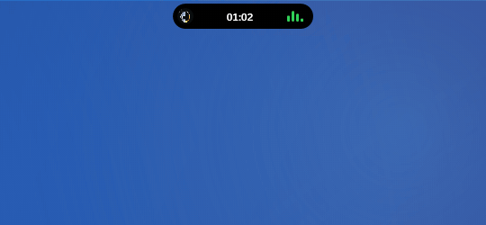
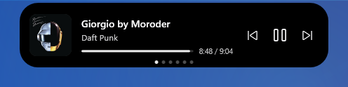
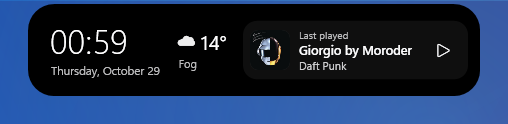
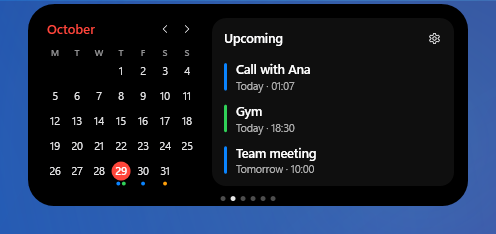
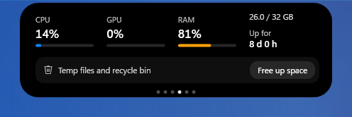
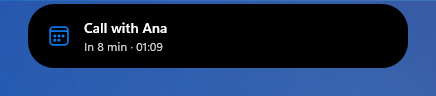

# DeskIsleBar

**English** | [Español](README.es.md)

A small floating island for Windows that shows what matters without getting in the way: the music that is playing, your notifications, the calendar, the weather and the state of your PC — in a black pill that expands when something happens and shrinks back when it is done.

**Website:** [facughub.github.io/DeskIsleBar](https://facughub.github.io/DeskIsleBar/)

<p align="center"></p>

| | |
|---|---|
|  |  |
|  |  |
|  |  |

## Features

- **Music** — cover, title, controls and progress for the app that is playing (Tidal, Spotify, YouTube Music, Apple Music or anything that uses the Windows media controls). The volume wheel moves the app's own volume, not the whole system (if the music plays in a browser, like YouTube Music, it moves the system volume).
- **App notifications** — notifications from your apps appear in the island, with their icon. One click opens the app (or the chat, when the app allows it, like WhatsApp Web). With *Do not disturb* turned on in Windows, the island can replace Windows' own banners (or respect *Do not disturb*, your choice).
- **Calendar** — upcoming events from your Google or Outlook calendars (private iCal links), with a navigable month view.
- **Weather** — current weather and today's high and low for your city (Open-Meteo).
- **PC** — CPU, GPU and RAM usage, uptime, and a "free up space" tool for old temporary files and the recycle bin.
- **Quick notes**, **timers** and **Pomodoro** — with an optional focus mode: while you study, notifications wait for the break.
- **Alerts** — each one can be turned on or off in *Settings → Alerts*:
  - low battery of controllers and Bluetooth devices (any brand that reports it), with the device's name;
  - controllers, headphones/speakers and USB drives connected or disconnected;
  - event reminders 10 minutes before;
  - camera or microphone in use, and which app is using them;
  - laptop battery (charging, on battery, low);
  - Caps Lock on/off, internet down / back online, image copied (Win+Shift+S).
- **Stays out of your games** — it hides while you play in full screen; with a full-screen video it only appears for notifications. Critical alerts (like a controller about to die) still show up.
- **Light on resources** — around 55 MB of RAM and well under 1% CPU.
- **English and Spanish** — follows your Windows language automatically, or choose one in the options.

## How to use it

- **Open it:** hover over the island. It opens on the music (if something is playing) or on Home, and closes when you move the mouse away.
- **Change panel:** drag left or right on the island (it also works over buttons). The dots at the bottom show where you are (Music/Home → Calendar → Weather → PC → Notes → Shortcuts) and clicking one jumps to that panel. Arrows ‹ › also appear when you move the mouse near a side.
- **Move it:** drag the island anywhere on the screen. It remembers the spot and grows towards the free side (from the bottom it grows upwards, from a side it grows towards the center). *Center* in the settings brings it back to the top.
- **Volume:** turn the mouse wheel over the island. While music is playing it changes that app's volume; otherwise, the system volume.
- **Music:** click the cover to bring the app to the front; drag the progress bar to jump to a part of the song.
- **Timers:** in *Shortcuts* — Pomodoro (25 + 5), 45 + 10, 5 and 15 minutes, or *Custom* (choose the minutes with the buttons or the wheel). The countdown stays on the island while it runs.
- **Calendar:** click a day to see its events; click an event to open that day in Google Calendar or Outlook.
- **Settings:** the gear in *Shortcuts*. The arrow at the top left goes back.

## Requirements

- Windows 10 version 2004 (build 19041) or later, or Windows 11, 64-bit. It has been tested on Windows 11.
- Nothing else: the installer includes everything it needs (.NET too).

## Installation

<!-- TODO: Microsoft Store link, once published -->

Download the installer from the [website](https://facughub.github.io/DeskIsleBar/) or from [Releases](../../releases) (`DeskIsleBar-Setup-<version>.exe`) and run it. It installs for your user only (no administrator permissions), adds DeskIsleBar to the Start menu and, if you want, starts it with Windows. You can change that later in the island's options.

To update you don't need to download anything: when there's a new version, the island lets you know and updates with one click, keeping your settings (you can also check with the button in *Options*).

## FAQ

**Does DeskIsleBar collect my data?**
No. There is no telemetry, no analytics, no account and no server of our own. DeskIsleBar only connects to the internet for three things:
- **Weather:** it sends the name of the city you type (and then its coordinates) to [Open-Meteo](https://open-meteo.com/), a free weather service, without any personal identifier.
- **Calendar:** it downloads the iCal links *you* add, directly from Google or Outlook.
- **Updates:** at startup, once a day and when you check from *Options*, it asks GitHub which version is the latest (without sending any of your data).

Nothing else leaves your PC. More detail in the [privacy policy](https://facughub.github.io/DeskIsleBar/privacidad.html).

**Does it read my notifications?**
Yes, to show them in the island — locally and read-only. They never leave your PC and their content is not written to any log. You can turn it off in the options at any time.

**What does it store, and where?**
Your settings, notes and the island's position live in `%LOCALAPPDATA%\DeskIsleBar`. Calendar links work like passwords, so they are encrypted with Windows DPAPI: only your Windows user can read them. A small technical log (`deskislebar.log`, in that same folder) records events and errors, such as which app sent a notification. It never records the content of notifications, of the messages your scripts send with `--aviso`, or your calendar links.

**Does it need administrator permissions?**
No. Everything runs as your user, including *Start with Windows*.

**Will it bother me while I play?**
No. It hides in full-screen games and keeps ordinary notifications in a queue until you leave. Only critical alerts (controller battery about to run out, timer finished, hardware errors) appear on top of borderless games. Games in *exclusive* full screen don't allow anything on top at all.

**What does "Free up space" delete?**
Only files older than one day in your temporary folder (`%TEMP%`), skipping anything that is in use, and it empties the recycle bin. It always shows you what it found and asks before deleting.

**Why does Windows SmartScreen warn me when I open it?**
The GitHub download is not code-signed yet, so Windows doesn't recognize it. You can choose *More info → Run anyway*. The Microsoft Store version doesn't show this warning.

**Can scripts send messages to the island?**
Yes: `DeskIsleBar.exe --aviso "Title" "Detail" [--icono info|alerta|candado|joystick|campana|red] [--color naranja|rojo|verde|azul] [--fijo]` shows a message in the island that is already running (`--fijo` keeps it until you click it).

**How do I uninstall it?**
Like any other program: *Settings → Apps → Installed apps → DeskIsleBar → Uninstall*. It closes the island if it is open, removes *Start with Windows* and asks whether to also delete your settings, notes and linked calendars (`%LOCALAPPDATA%\DeskIsleBar`).

## Found a bug? Have an idea?

- **Bugs and suggestions:** open an [issue](../../issues) describing what happened and what you expected. Attaching the diagnostics report helps a lot: run `DeskIsleBar.exe --diagnostico` and it opens a text file listing which Windows features the island could read on your PC (it doesn't send anything anywhere).
- **Questions and ideas:** [Discussions](../../discussions).
- **Private matters** (for example, a security problem): write to [facughub.apps@gmail.com](mailto:facughub.apps@gmail.com).
- **Support for more devices:** battery readings for brands that only expose it through their own software (Corsair, Logitech, Razer, SteelSeries…) can be added as optional integrations. If you own one of those devices and want to help, open an issue or a pull request: the integration should only turn on when the brand's software is installed, and it needs someone with the hardware to test it.

## Support the project

DeskIsleBar is free. If it is useful to you and you want to support its development:

- ☕ [Buy me a coffee on Cafecito](https://cafecito.app/facughub) (Argentina, pesos via Mercado Pago or bank transfer)

## Building from source

```
dotnet build DeskIsleBar.csproj -c Release
```

Requires the .NET 10 SDK. The executable ends up in `bin\Release\net10.0-windows10.0.19041.0\`.

## License

[GPL-3.0](LICENSE). You can use, study, modify and share DeskIsleBar; modified versions you distribute must remain open source under the same license.
